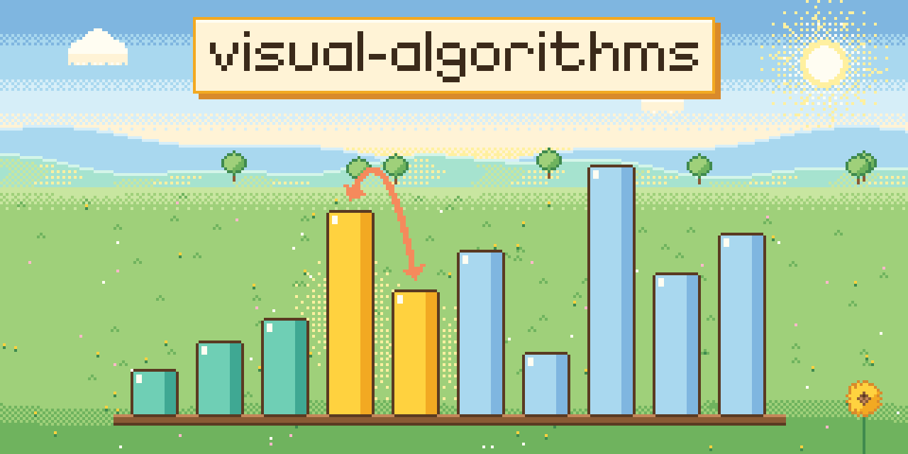
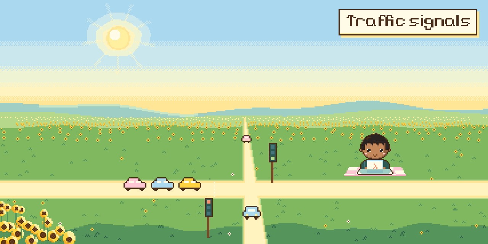
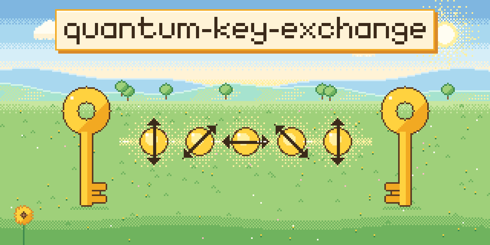
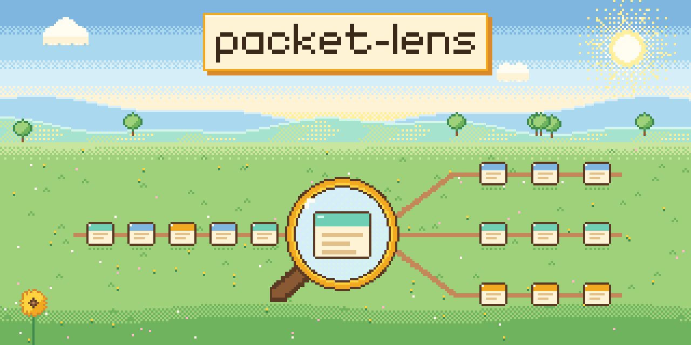

<picture>
  <source media="(prefers-reduced-motion: reduce)" srcset="images/meadow-still.png">
  
</picture>

I study how computing students learn, and I build software that shows how things work.

- PhD in computing education at UNSW from February 2027.
- Co-founder and CTO of PropRetire.
- Casual academic at UNSW and the University of Sydney, and cyber security officer at DPIRD.

[ORCID](https://orcid.org/0000-0002-0785-5357) · [LinkedIn](https://www.linkedin.com/in/varunswaika/)

## Projects

<table>
  <tr>
    <td width="50%" valign="top">
       
      <a href="https://github.com/varunswaika/net-visual"><b>net-visual</b></a> 
      Six network simulations. 
      <a href="https://varunswaika.github.io/net-visual/">Live&nbsp;demo</a>
    </td>
    <td width="50%" valign="top">
       
      <a href="https://github.com/varunswaika/visual-algorithms"><b>visual-algorithms</b></a> 
      44 interactive algorithm demos. 
      <a href="https://varunswaika.github.io/visual-algorithms/">Live&nbsp;demo</a>
    </td>
  </tr>
  <tr>
    <td width="50%" valign="top">
       
      <a href="https://github.com/varunswaika/chess-engine"><b>chess-engine</b></a> 
      Rust chess engine in the browser. 
      <a href="https://varunswaika.github.io/chess-engine/">Live&nbsp;demo</a>
    </td>
    <td width="50%" valign="top">
       
      <a href="https://github.com/varunswaika/traffic-signals"><b>traffic-signals</b></a> 
      Compares traffic signal controllers. 
      <a href="https://varunswaika.github.io/traffic-signals/">Live&nbsp;demo</a>
    </td>
  </tr>
  <tr>
    <td width="50%" valign="top">
       
      <a href="https://github.com/varunswaika/quantum-key-exchange"><b>quantum-key-exchange</b></a> 
      BB84 in Rust. 
      <a href="https://varunswaika.github.io/quantum-key-exchange/">Live&nbsp;demo</a>
    </td>
    <td width="50%" valign="top">
       
      <a href="https://github.com/varunswaika/packet-lens"><b>packet-lens</b></a> 
      Reads packet captures, in Rust. 
      <a href="https://varunswaika.github.io/packet-lens/">Live&nbsp;demo</a>
    </td>
  </tr>
</table>

### More tools

- [huffman](https://github.com/varunswaika/huffman): Rust file compressor with a page that shows its code tree. [Live&nbsp;demo](https://varunswaika.github.io/huffman/)
- [fog-scheduling](https://github.com/varunswaika/fog-scheduling): six scheduling policies compared over many seeds. [Live&nbsp;demo](https://varunswaika.github.io/fog-scheduling/)
- [hairline](https://github.com/varunswaika/hairline): line drawings that move with the pointer. [Live&nbsp;demo](https://varunswaika.github.io/hairline/)
- [xdp-guard](https://github.com/varunswaika/xdp-guard): per-source rate limiter for Linux, as an XDP program in Rust.
- [dotman](https://github.com/varunswaika/dotman): one theme file for a whole desktop.
- [dictate](https://github.com/varunswaika/dictate): hold-to-talk dictation that runs on your own computer.
- [stardew-mods](https://github.com/varunswaika/stardew-mods): two mods for co-op Stardew Valley.

## Research

How students learn to write proofs, and whether checking a proof step by step helps them write one on paper. I also look at where theory and practice meet in early postgraduate computing.

- *Formal proofs to teach informal proof writing.* AAEE 2026, accepted.
- *An Unclear Theory-Practice Connection in Early Postgraduate Computing.* ACM COMPUTE 2026, accepted.
- *Neural Network Aided Kalman Filter to Maximize Accuracy.* ICONAT 2022 (IEEE). [doi:10.1109/ICONAT53423.2022.9726059](https://doi.org/10.1109/ICONAT53423.2022.9726059) · [code](https://github.com/varunswaika/Neural-Network-Aided-Kalman-Filter-to-Maximize-Accuracy)
- *Secure Wireless Smart Car Door Unlocking System.* ICICNIS 2022, Springer LNNS vol. 528. [doi:10.1007/978-981-19-5845-8_8](https://doi.org/10.1007/978-981-19-5845-8_8) · [code](https://github.com/varunswaika/Secure-Wireless-Smart-Car-Door-Unlocking-System)
- *Direction Based-Improved Ant Based Routing Algorithm.* I4Tech 2022 (IEEE). [doi:10.1109/I4Tech55392.2022.9952718](https://doi.org/10.1109/I4Tech55392.2022.9952718) · [code](https://github.com/varunswaika/Direction-Based-Improved-Ant-Based-Routing-Algorithm)
