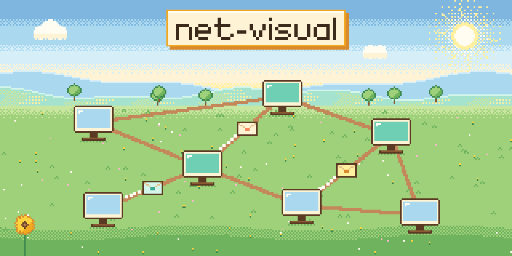
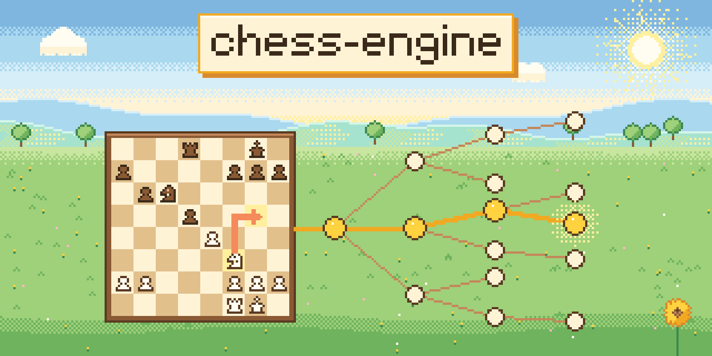
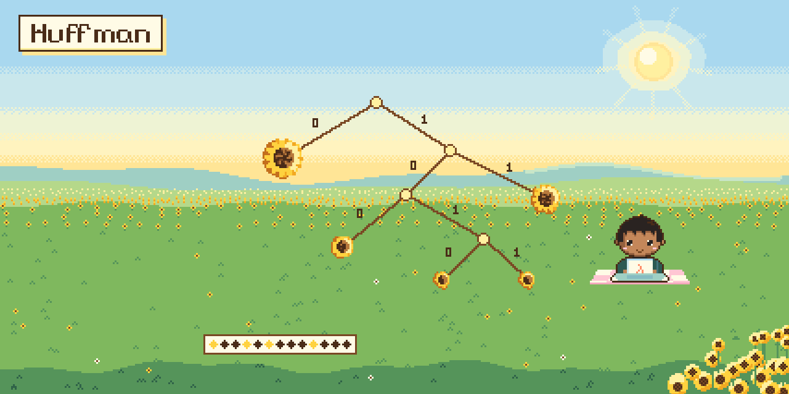

# Varun Agarwal

I study how computing students learn, and I build software that shows how things work.

- PhD in computing education at UNSW from February 2027.
- Co-founder and CTO of PropRetire.
- Casual academic at UNSW and the University of Sydney, and cyber security officer at DPIRD.

ORCID: [0000-0002-0785-5357](https://orcid.org/0000-0002-0785-5357)

## Research

How students learn to write proofs, and whether checking a proof step by step helps them write one on paper. I also look at where theory and practice meet in early postgraduate computing.

## Projects

<table>
  <tr>
    <td width="50%" valign="top"> <a href="https://github.com/VarunAgarwalOfficial/net-visual"><b>net-visual</b></a> Network simulations for teaching, in Rust and React</td>
    <td width="50%" valign="top"> <a href="https://github.com/VarunAgarwalOfficial/visual-algorithms"><b>visual-algorithms</b></a> · <a href="https://varunagarwalofficial.github.io/visual-algorithms/">live demo</a> 44 interactive algorithm demos</td>
  </tr>
  <tr>
    <td width="50%" valign="top"> <a href="https://github.com/VarunAgarwalOfficial/chess-engine"><b>chess-engine</b></a> A Rust chess engine with a browser board</td>
    <td width="50%" valign="top"> <a href="https://github.com/VarunAgarwalOfficial/traffic-signals"><b>traffic-signals</b></a> Signal controllers compared on the same traffic</td>
  </tr>
  <tr>
    <td width="50%" valign="top"> <a href="https://github.com/VarunAgarwalOfficial/quantum-key-exchange"><b>quantum-key-exchange</b></a> BB84 key exchange, simulated in Rust</td>
    <td width="50%" valign="top"> <a href="https://github.com/VarunAgarwalOfficial/huffman"><b>huffman</b></a> A Rust Huffman compressor that shows its tree</td>
  </tr>
</table>

More tools: [packet-lens](https://github.com/VarunAgarwalOfficial/packet-lens) (capture reader, CLI and browser) · [xdp-guard](https://github.com/VarunAgarwalOfficial/xdp-guard) (per-source rate limiter in XDP) · [dotman](https://github.com/VarunAgarwalOfficial/dotman) (one theme file for a whole desktop) · [dictate](https://github.com/VarunAgarwalOfficial/dictate) (hold-to-talk dictation)

## Publications

- *Formal proofs to teach informal proof writing.* AAEE 2026, accepted.
- *An Unclear Theory-Practice Connection in Early Postgraduate Computing.* ACM COMPUTE 2026, accepted.
- *Neural Network Aided Kalman Filter to Maximize Accuracy.* ICONAT 2022 (IEEE). [doi:10.1109/ICONAT53423.2022.9726059](https://doi.org/10.1109/ICONAT53423.2022.9726059) · [code](https://github.com/VarunAgarwalOfficial/Neural-Network-Aided-Kalman-Filter-to-Maximize-Accuracy)
- *Secure Wireless Smart Car Door Unlocking System.* ICICNIS 2022, Springer LNNS vol. 528. [doi:10.1007/978-981-19-5845-8_8](https://doi.org/10.1007/978-981-19-5845-8_8) · [code](https://github.com/VarunAgarwalOfficial/Secure-Wireless-Smart-Car-Door-Unlocking-System)
- *Direction Based-Improved Ant Based Routing Algorithm.* I4Tech 2022 (IEEE). [doi:10.1109/I4Tech55392.2022.9952718](https://doi.org/10.1109/I4Tech55392.2022.9952718) · [code](https://github.com/VarunAgarwalOfficial/Direction-Based-Improved-Ant-Based-Routing-Algorithm)
